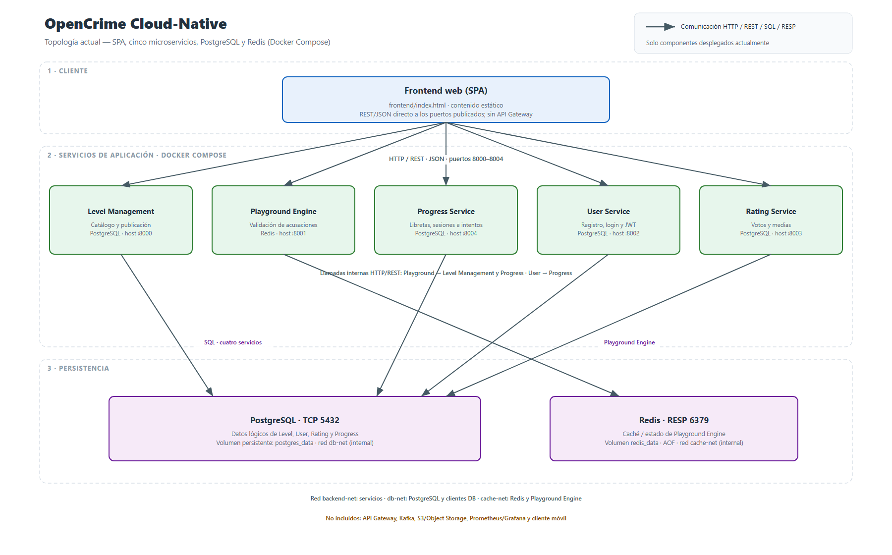

# OpenCrime Cloud-Native



> **Figura 1.** Arquitectura desplegada actualmente con Docker Compose. La SPA llama directamente a los microservicios; no hay API Gateway en el entorno actual.

## 1. Descripción del Dominio y Casos de Uso

### 1.1 Problema de Negocio

Los juegos de deducción tienen una gran demanda, pero las soluciones actuales del mercado presentan limitaciones que este proyecto busca resolver:

- **Contenido estático y no escalable:** Los juegos de misterio digitales suelen ofrecerse como contenido cerrado y de un solo uso, lo que reduce la retención y obliga al editor a producir cada nivel manualmente. No existe un canal ágil para que la propia comunidad publique, comparta y rejuegue misterios.
- **Modelo monolítico y desaprovechamiento de la nube:** Muchas implementaciones concentran lógica de negocio, persistencia y renderizado en una sola aplicación, lo que dificulta escalar de forma independiente la parte más costosa (la validación del tablero) y provoca sobrecostes en horas valle o caídas en horas punta.
- **Validación de la solución acoplada al cliente:** Cuando la comprobación de si un misterio está resuelto vive en el navegador, el resultado es manipulable, difícil de auditar y no sirve como base para clasificaciones, logros o análisis de dificultad.
- **Ausencia de métrica de dificultad y comunidad:** Sin un backend que registre intentos, aciertos y tiempos, no es posible puntuar niveles, recomendar misterios por dificultad ni construir una economía de contenido (niveles destacados, autores reconocidos).

En resumen, el problema de negocio es **cómo ofrecer un juego de deducción lógico que sea continuamente ampliable por la comunidad, verificable de forma fiable en el servidor y capaz de escalar de forma elástica y eficiente en coste según la demanda**.

La aplicación se plantea como **Cloud-Native** precisamente para atacar esas limitaciones: servicios independientes que escalan de forma granular, validación centralizada en el servidor y un modelo de contenido abierto a la comunidad.

### 1.2 Casos de Uso Principales

| # | Caso de uso | Actor | Descripción |
|---|-------------|-------|-------------|
| CU-01 | **Crear y publicar un misterio** | Autor / Creador | Un miembro de la comunidad diseña un nivel con título, descripción, dificultad, tarjetas y composición de solución y lo publica mediante `POST /api/levels/`. |
| CU-02 | **Explorar el catálogo de misterios** | Jugador | El jugador consulta el catálogo paginado; actualmente puede filtrar por autor y elegir un caso. |
| CU-03 | **Jugar un misterio (renderizar el tablero)** | Jugador | El jugador abre un nivel y el sistema recupera sus tarjetas (`GET /api/levels/{level_id}`) para pintar el tablón en HTML/JS. |
| CU-04 | **Validar la solución del tablero** | Jugador | El jugador prepara una acusación seleccionando tarjetas y la envía a `POST /api/engine/validate`; el motor devuelve el resultado y retroalimentación. |
| CU-05 | **Registrar progreso** | Sistema | Para usuarios autenticados, Progress Service almacena intentos, sesiones y estadísticas personales por caso. No hay actualmente cálculo global de dificultad ni medición de consumo cloud. |
| CU-06 | **Moderar contenido** | Administrador / Moderador | Caso de uso previsto; la API actual no implementa todavía operaciones de moderación. |

**Actores principales actuales:** Jugador y Autor/Creador. Administrador/Moderador es un rol previsto, pero la API todavía no expone operaciones de moderación. El mapeo conceptual a roles NIST SP 500-292 se desarrolla en la [sección 3](#3-mapeo-de-actores-nist-sp-500-292).

## 2. Justificación NIST SP 800-145

La arquitectura de **Crime Board Cloud-Native** se alinea con las cinco características esenciales del modelo Cloud definidas en el documento NIST SP 800-145 (*The NIST Definition of Cloud Computing*). A continuación se analiza cómo cada una de ellas se materializa en la aplicación.

> **Alcance actual:** esta sección justifica el diseño y su posible evolución en la nube; no afirma que todas las capacidades de una plataforma cloud estén desplegadas. El entorno implementado es Docker Compose local: no incluye autoescalado, medición de consumo para facturación ni alta disponibilidad.

### 2.1 Autoservicio bajo demanda (*On-demand self-service*)

El consumidor aprovisiona capacidades de cómputo de forma unilateral, sin interacción humana con el proveedor del servicio.

- Un **Autor** puede registrarse y publicar un misterio (`POST /api/levels/`) desde la aplicación, sin intervención manual del operador para cada caso.
- Un **Jugador** puede consultar un misterio (`GET /api/levels/{level_id}`) y enviar una acusación al motor (`POST /api/engine/validate`) bajo demanda.
- Esto representa autoservicio a nivel de funcionalidad de la aplicación; el aprovisionamiento de infraestructura sigue siendo responsabilidad del operador y no se realiza automáticamente por cada petición.

### 2.2 Acceso amplio a la red (*Broad network access*)

Las capacidades están disponibles a través de la red mediante mecanismos estándar, accesibles desde clientes heterogéneos (navegadores de escritorio, móviles, tablets).

- La SPA consume **API REST con JSON sobre HTTP**. En el Compose local los servicios se publican en `127.0.0.1`; HTTPS requeriría un proxy o ingress con TLS, que no forma parte del despliegue actual.
- El tablero se renderiza como HTML/JS en el cliente ([sección 5](#5-especificación-api-rest)), de modo que no hace falta instalar una aplicación nativa para consultar y jugar casos.
- El formato REST/JSON permite integrar otros clientes en el futuro. HTTPS requerirá terminar TLS en un proxy o ingress, no incluido en el despliegue local.

### 2.3 Asignación común de recursos (*Resource pooling*)

El modelo cloud permite agrupar recursos para servir a múltiples consumidores. En el prototipo, los servicios y la base de datos son compartidos; el aislamiento lógico depende de la autenticación y de las reglas de cada servicio.

- El Compose local levanta instancias compartidas de los cinco microservicios, PostgreSQL y Redis para todos los usuarios de la instalación.
- La asignación de recursos entre nodos y el aislamiento físico dependen de la futura plataforma de despliegue; no los proporciona Docker Compose.
- Las APIs autentican las operaciones de cuenta y progreso con JWT y protegen algunas llamadas internas con `X-Internal-Api-Key`.

### 2.4 Rápida elasticidad (*Rapid elasticity*)

Las capacidades pueden escalar de forma elástica, incluso automática, hacia arriba y hacia abajo según la demanda, de modo que los recursos disponibles aparenten ser ilimitados.

- La separación de servicios permite plantear escalado independiente: por ejemplo, replicar **Playground Engine Service** con un orquestador cloud si aumenta la demanda.
- **Ese escalado no está implementado en el Compose actual**, que levanta una instancia de cada servicio y no configura autoescalado ni balanceo.

### 2.5 Servicio medido (*Measured service*)

Los sistemas cloud controlan y optimizan automáticamente el uso de recursos mediante capacidades de medición, proporcionando transparencia al proveedor y al consumidor.

- `Progress Service` registra intentos autenticados y estadísticas **por jugador y caso** (intentos, resolución y tiempo), útiles para el perfil y el seguimiento del juego.
- No hay actualmente instrumentación de consumo de CPU, memoria o almacenamiento, métricas Prometheus ni facturación por uso. Por tanto, el servicio medido de NIST es una **posible evolución**, no una capacidad operativa ya desplegada.

### 2.6 Síntesis

| Característica NIST SP 800-145 | Cómo se materializa en Crime Board Cloud-Native |
|-------------------------------|------------------------------------------------|
| Autoservicio bajo demanda | Los usuarios pueden publicar y jugar mediante la API; no aprovisionan infraestructura. |
| Acceso amplio a la red | SPA y APIs REST/JSON; HTTP en Compose y HTTPS pendiente de un proxy/ingress. |
| Asignación común de recursos | Servicios y persistencia compartidos en la instalación local; aislamiento lógico en las APIs. |
| Rápida elasticidad | Posible al desplegar en un orquestador cloud; no implementada por Compose. |
| Servicio medido | Progress mide actividad de juego por usuario; no hay métricas de consumo cloud ni facturación. |

## 3. Mapeo de Actores NIST SP 500-292

El documento NIST SP 500-292 (*NIST Cloud Computing Reference Architecture*) define un conjunto de actores que interactúan en el ecosistema cloud. A continuación se identifican de forma explícita los roles aplicables a **Crime Board Cloud-Native** y se analiza el impacto económico de cada uno.

| Rol NIST SP 500-292 | Actor en Crime Board | Responsabilidad principal |
|---------------------|----------------------|---------------------------|
| **Consumidor** (*Cloud Consumer*) | Jugadores y Autores de misterios | Consume los servicios de la plataforma (jugar, publicar, consultar métricas). |
| **Proveedor** (*Cloud Provider*) | Equipo propietario de la plataforma | Desarrolla, opera y ofrece los servicios de niveles y de validación. |
| **Intermediario** (*Cloud Broker*) | Proveedor de infraestructura cloud / marketplace | Intermedia entre el proveedor y los recursos, agregando o mejorando servicios. |
| **Auditor** (*Cloud Auditor*) | Equipo de seguridad y cumplimiento | Evalúa de forma independiente el rendimiento, la seguridad y el cumplimiento. |
| **Operador** (*Cloud Operator / Carrier*) | Equipo DevOps / red de transporte | Gestiona la infraestructura y transporta el tráfico de red. |

### 3.1 Consumidor (*Cloud Consumer*)

Es quien utiliza los servicios de la plataforma. En Crime Board se distinguen dos perfiles:

- **Jugador:** consume el catálogo (`GET /api/levels/{level_id}`) y el motor de validación (`POST /api/engine/validate`).
- **Autor/Creador:** consume las capacidades de publicación (`POST /api/levels/`) para generar contenido.

**Impacto económico:**
- El consumidor sustituye un **modelo de pago por producto** (comprar un juego cerrado) por un **modelo de acceso o suscripción**, con menor coste inicial y sin inversión en hardware ni mantenimiento.
- Su coste es **variable y proporcional al uso** (partidas jugadas, niveles publicados), lo que reduce el gasto en periodos de baja actividad y traslada el riesgo de capacidad al proveedor.
- La existencia de contenido generado por la comunidad **aumenta el valor percibido sin aumentar el precio**, alargando el ciclo de vida del servicio y mejorando la retención (y por tanto el ingreso recurrente).

### 3.2 Proveedor (*Cloud Provider*)

Es el equipo/propietario que crea, despliega y mantiene los cinco servicios de aplicación (Level Management, Playground Engine, User, Rating y Progress) y su persistencia.

**Impacto económico:**
- El proveedor convierte **costes fijos (CAPEX)** de servidores propios en **costes operativos variables (OPEX)** ligados al consumo real de la nube.
- En una futura plataforma con escalado automático, la arquitectura de microservicios podría reducir el sobreaprovisionamiento; el Compose actual no escala automáticamente.
- El contenido de la comunidad **reduce el coste de producción de niveles** (cada autor financia con su tiempo parte del catálogo), mejorando la relación entre catálogo ofrecido y coste de creación.
- Si en el futuro se añade medición de consumo, esta podría habilitar modelos de pago por uso; el servicio medido y la facturación no están implementados actualmente.

### 3.3 Intermediario (*Cloud Broker*)

Intermedia entre el consumidor y el proveedor de servicios cloud. En este proyecto lo encarna el **proveedor de infraestructura cloud** (IaaS/PaaS) y el eventual **marketplace de contenido**.

**Impacto económico:**
- Permite al proveedor **abstraerse de la gestión de centros de datos**, pagando solo por recursos consumidos y evitando grandes inversiones iniciales.
- El *broker* de infraestructura ofrece **economías de escala** (precios por volumen, regiones múltiples) que un equipo pequeño no podría negociar por sí solo.
- Un marketplace de niveles puede actuar como intermediario de monetización, cobrando una **comisión** por transacción y ampliando la distribución del contenido sin coste comercial propio.

### 3.4 Auditor (*Cloud Auditor*)

Evaluador independiente del rendimiento, la seguridad y el cumplimiento. En Crime Board corresponde al **equipo de seguridad/cumplimiento** (interno o externo) que verifica:

- Que la validación de soluciones ocurre en el servidor (`POST /api/engine/validate`) y no es manipulable por el cliente.
- El correcto aislamiento de datos entre autores y jugadores (*multi-tenant*, [sección 2.3](#23-asignación-común-de-recursos-resource-pooling)).
- La exactitud de las métricas para facturación, si se incorporan en una futura plataforma cloud; actualmente no hay medición de consumo ni facturación.

**Impacto económico:**
- Una auditoría favorable reduce el **riesgo financiero** asociado a incidentes de seguridad, sanciones por incumplimiento (p. ej. RGPD) e interrupciones del servicio.
- La auditabilidad de la medición **protege los ingresos** al evitar disputas de facturación y fraudes en el uso del servicio.
- La confianza certificada **facilita la captación de usuarios corporativos** y acuerdos con terceros (niveles educativos, patrocinios), con precios superiores.

### 3.5 Operador (*Cloud Operator / Cloud Carrier*)

Gestiona la infraestructura y transporta la red. Correspondría al **equipo DevOps** de la plataforma y a los **proveedores de red/CDN** que distribuyen el tráfico hacia los clientes ([sección 2.2](#22-acceso-amplio-a-la-red-broad-network-access)).

**Impacto económico:**
- La automatización operativa (despliegue continuo, autoescalado y observabilidad) podría reducir el coste de operación en una futura plataforma cloud; solo la integración continua está configurada en el repositorio actual.
- El uso de CDN y transporte de red optimizado **disminuye la latencia y el consumo de ancho de banda**, mejorando la experiencia y reduciendo el abandono (impacto directo en ingreso recurrente).
- La operación elástica evita el **sobreaprovisionamiento**, alineando el gasto de infraestructura con la demanda real.

### 3.6 Síntesis del impacto económico

| Rol | Palanca económica clave | Efecto |
|-----|-------------------------|--------|
| Consumidor | Pago por uso / suscripción | Menor coste de entrada; gasto proporcional al uso. |
| Proveedor | CAPEX → OPEX + contenido de la comunidad | Mayor margen y menor coste de producción de niveles. |
| Intermediario | Economías de escala y comisiones | Menor inversión inicial y nuevas vías de ingreso. |
| Auditor | Reducción de riesgo y confianza | Menos sanciones, ingresos protegidos y acceso a clientes premium. |
| Operador | Automatización y eficiencia de red | Menor coste operativo y menor abandono de usuarios. |

## 4. Arquitectura actual de microservicios

El entorno local se orquesta con Docker Compose. La SPA es un archivo estático (`frontend/index.html`) y **no está contenerizada**: el navegador llama directamente a los puertos publicados de los cinco servicios. No existe API Gateway/Ingress en el Compose actual.

### 4.1 Diagrama de arquitectura

La [Figura 1](docs/architecture.png) muestra los componentes que sí están en el repositorio y en `compose.yaml`. Las comunicaciones entre servicios son síncronas mediante HTTP/REST; PostgreSQL y Redis se alcanzan por redes Docker internas.

### 4.2 Componentes

| Capa | Componente | Responsabilidad y conexión actual |
|------|------------|----------------------------------|
| Cliente | **SPA web** (`frontend/index.html`) | Interfaz estática; llama directamente a los servicios por HTTP/JSON. Se puede abrir localmente o servir con un servidor estático. |
| Microservicio | **Level Management Service** (`:8000`) | Catálogo, creación y lectura de casos; usa PostgreSQL. |
| Microservicio | **Playground Engine Service** (`:8001`) | Obtiene el caso desde Level Management, valida acusaciones y registra intentos autenticados en Progress; usa Redis para caché/estado. |
| Microservicio | **User Service** (`:8002`) | Registro, login, emisión/verificación de JWT y gestión de cuentas; usa PostgreSQL. |
| Microservicio | **Rating Service** (`:8003`) | Guarda y consulta valoraciones; usa PostgreSQL y JWT para votar. |
| Microservicio | **Progress Service** (`:8004`) | Libretas, sesiones, workspace, intentos e historial por usuario; usa PostgreSQL. |
| Persistencia | **PostgreSQL** (`5432`) | Una instancia compartida en Compose; cada servicio mantiene sus propias tablas/datos lógicos. Volumen `postgres_data`. |
| Caché | **Redis** (`6379`) | Caché/estado usado por Playground Engine; volumen `redis_data` y AOF habilitado. |

Los servicios de aplicación se conectan por `backend-net`. PostgreSQL está aislado en `db-net` y Redis en `cache-net` (ambas redes internas). Los puertos de los servicios se enlazan a loopback por defecto. La autenticación JWT es verificada localmente por los servicios que la necesitan; las llamadas internas protegidas usan `X-Internal-Api-Key`.

### 4.3 Protocolos de comunicación

| Tramo | Protocolo | Formato / Notas |
|-------|-----------|-----------------|
| SPA → microservicios | **HTTP · REST/JSON** | Llamadas directas desde el navegador a `127.0.0.1:8000`–`:8004` en Compose; no hay gateway ni TLS local. |
| Playground Engine → Level Management | **HTTP · REST/JSON** | Obtiene los datos del caso por la red interna de Compose. |
| Playground Engine / User Service → Progress Service | **HTTP · REST/JSON** | Registro de intentos y purga de progreso mediante endpoints internos protegidos. |
| Servicios de datos → PostgreSQL | **SQL sobre TCP** | Puerto interno `5432`, accesible por `db-net`. |
| Playground Engine → Redis | **RESP** | Puerto interno `6379`, accesible por `cache-net`. |

La comunicación implementada es síncrona. Kafka, S3/Object Storage, un API Gateway/Ingress, un cliente móvil y Prometheus/Grafana **no están incluidos** en el repositorio desplegable actual.

### 4.4 Almacenamiento y persistencia

- **PostgreSQL:** almacenamiento relacional persistente compartido por Level Management, User, Rating y Progress; los datos se separan lógicamente por servicio.
- **Redis:** caché/estado usado por Playground Engine; Compose habilita AOF y monta el volumen persistente `redis_data`.
- **Navegador:** algunos datos locales de la SPA se guardan en `localStorage`; la cuenta autenticada sincroniza el progreso con Progress Service.

No hay almacenamiento S3, Kafka ni base de métricas en el despliegue actual. La arquitectura cloud con almacenamiento, mensajería y observabilidad gestionados queda como posible evolución, no como componente implementado.

## 5. Especificación API REST

### Level Management Service
- `GET /api/levels/`: catálogo paginado (`limit`, `offset`) y filtro por autor (`creator_username`).
- `POST /api/levels/`
  - **Descripción:** Publica un nuevo nivel de la comunidad.
  - **Payload:** JSON con `title`, `description`, `difficulty`, `cards` y `solution_card_ids`; el autor se obtiene del JWT.
- `GET /api/levels/{level_id}`
  - **Descripción:** Obtiene los datos de un misterio para renderizar el tablero en HTML/JS.

### Playground Engine Service
- `POST /api/engine/validate`
  - **Descripción:** Evalúa el estado actual del tablero del jugador.
  - **Payload:** JSON con `level_id`, `selected_card_ids`, `session_id` y `client_attempt_id` opcionales.
  - **Respuesta:** JSON con `{"solved": boolean, "feedback_message": string, "progress": {...} | null}`.
  - Si llega un JWT válido, el intento se registra en `progress-service` con timeout corto y **fail-open**: una avería del progreso nunca bloquea el veredicto.

### User Service
- `POST /api/users/register` y `POST /api/users/login`: registro y emisión de JWT.
- `GET /api/users/me`: cuenta asociada al token actual.
- `DELETE /api/users/{user_id}`: eliminación de la propia cuenta.

### Rating Service
- `POST /api/ratings/`: crea o actualiza la valoración autenticada.
- `GET /api/ratings/levels/{level_id}`: resumen de un nivel.
- `GET/POST /api/ratings/levels/batch`: resúmenes de varios niveles.
- `GET /api/ratings/me`: valoraciones de la cuenta actual.

### Progress Service
- `GET/PUT /api/progress/notes/{scope}`: libreta general (`general`) o por caso, con versión optimista y `409` en conflicto.
- `POST /api/progress/cases/{level_id}/sessions`: inicia o reanuda la partida activa.
- `POST /api/progress/cases/{level_id}/restart`: cierra la partida y abre una repetición.
- `GET /api/progress/cases/{level_id}/state` y `PUT /api/progress/cases/{level_id}/workspace`: sesión, tachados y selección de acusación.
- `GET /api/progress/me/summary` y `/api/progress/me/cases`: KPIs e historial del perfil.
- Endpoints internos con `X-Internal-Api-Key`: registro idempotente de intentos y purga al borrar cuenta.

### Perfil y libreta en la SPA
- La SPA sigue siendo un único `frontend/index.html`, sin build ni framework.
- El perfil agrega datos con `Promise.allSettled`: progreso, valoraciones propias y casos diseñados.
- La libreta funciona en local sin sesión y se sincroniza por versión al iniciar sesión. Los conflictos muestran ambas versiones y nunca borran texto sin confirmación.
- El reinicio de un caso autenticado se coordina con `progress-service`; la primera resolución registrada es inmutable.

### Puesta en marcha local

El comando por defecto levanta las imágenes de producción (`target: runtime`):

```bash
cp .env.example .env
docker compose up --build -d
# Tablero: sirve frontend/ con un servidor estático, p. ej. python -m http.server 8123
# Progress Service: http://127.0.0.1:8004/docs
```

Para desarrollo con recarga automática de código, combina el compose base con
el override de desarrollo:

```bash
docker compose -f compose.yaml -f compose.dev.yaml up --build -d
```

El override cambia el `build.target` de los microservicios a `development` y
monta `./services/<servicio>:/app` desde el host, de modo que `uvicorn --reload`
refleja los cambios sin reconstruir la imagen.

Sin `DATABASE_URL`, cada servicio arranca con repositorio en memoria para desarrollo y pruebas. En producción, `docker compose` inyecta PostgreSQL y los secretos compartidos.
