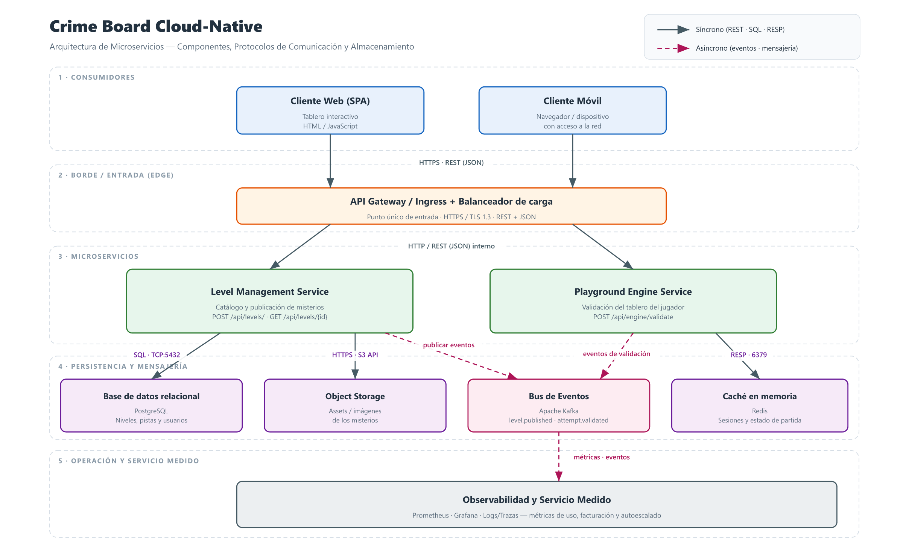

# Crime Board Cloud-Native
##### Por Manuel Martínez Cobos

Actividad realizada durante la asignatura **Cloud Computing: Fundamentos e Infraestructuras**, perteneciente al Master de Ingeniería Informática de la UGR

Plataforma interactiva *cloud-native* para **crear, compartir y resolver misterios lógicos** sobre un tablero de pistas y conexiones (un "crime board" digital).



> *[Figura 1](docs/architecture.png). Vista general de la arquitectura (detalle en la [sección 4](#4-arquitectura-de-microservicios)).*

## Índice

- [1. Descripción del Dominio y Casos de Uso](#1-descripción-del-dominio-y-casos-de-uso)
  - [1.1 Problema de Negocio](#11-problema-de-negocio)
  - [1.2 Casos de Uso Principales](#12-casos-de-uso-principales)
- [2. Justificación NIST SP 800-145](#2-justificación-nist-sp-800-145)
- [3. Mapeo de Actores NIST SP 500-292](#3-mapeo-de-actores-nist-sp-500-292)
- [4. Arquitectura de Microservicios](#4-arquitectura-de-microservicios)
  - [4.1 Diagrama de arquitectura](#41-diagrama-de-arquitectura)
  - [4.2 Componentes](#42-componentes)
  - [4.3 Protocolos de comunicación](#43-protocolos-de-comunicación)
  - [4.4 Almacenamiento y persistencia](#44-almacenamiento-y-persistencia)
- [5. Especificación API REST](#5-especificación-api-rest)

## 1. Descripción del Dominio y Casos de Uso

### 1.1 Problema de Negocio

Los juegos de deducción tienen una gran demanda, pero las soluciones actuales del mercado presentan limitaciones que este proyecto busca resolver:

- **Contenido estático y no escalable:** Los juegos de misterio digitales suelen ofrecerse como contenido cerrado y de un solo uso, lo que reduce la retención y obliga al editor a producir cada nivel manualmente. No existe un canal ágil para que la propia comunidad publique, comparta y rejuegue misterios.
- **Modelo monolítico y desaprovechamiento de la nube:** Muchas implementaciones concentran lógica de negocio, persistencia y renderizado en una sola aplicación, lo que dificulta escalar de forma independiente la parte más costosa (la validación del tablero) y provoca sobrecostes en horas valle o caídas en horas punta.
- **Validación de la solución acoplada al cliente:** Cuando la comprobación de si un misterio está resuelto vive en el navegador, el resultado es manipulable, difícil de auditar y no sirve como base para clasificaciones, logros o análisis de dificultad.
- **Ausencia de métrica de dificultad y comunidad:** Sin un backend que registre intentos, aciertos y tiempos, no es posible puntuar niveles, recomendar misterios por dificultad ni construir una economía de contenido (niveles destacados, autores reconocidos).

En resumen, el problema de negocio es **cómo ofrecer un juego de deducción lógico que sea continuamente ampliable por la comunidad, verificable de forma fiable en el servidor y capaz de escalar de forma elástica y eficiente en coste según la demanda**.

La aplicación se plantea como **Cloud-Native** precisamente para atacar esas limitaciones: servicios independientes que escalan de forma granular, validación centralizada en el servidor y un modelo de contenido abierto a la comunidad.

### 1.2 Casos de Uso Principales

| # | Caso de uso | Actor | Descripción |
|---|-------------|-------|-------------|
| CU-01 | **Crear y publicar un misterio** | Autor / Creador | Un miembro de la comunidad diseña un nivel (título, pistas/clues y las conexiones correctas) y lo publica mediante `POST /api/levels/` para que otros jugadores lo resuelvan. |
| CU-02 | **Explorar el catálogo de misterios** | Jugador | El jugador consulta los niveles disponibles, filtrando por dificultad, popularidad o autor, para elegir qué misterio resolver. |
| CU-03 | **Jugar un misterio (renderizar el tablero)** | Jugador | El jugador abre un nivel y el sistema recupera sus datos (`GET /api/levels/{level_id}`) para pintar el tablón con pistas y conexiones en HTML/JS. |
| CU-04 | **Validar la solución del tablero** | Jugador | El jugador traza los "hilos" entre pistas y envía sus conexiones a `POST /api/engine/validate`; el motor responde si el misterio está resuelto y una pista de retroalimentación. |
| CU-05 | **Registrar progreso y métricas de dificultad** | Sistema / Analista | El backend almacena intentos, tiempo y tasa de acierto para puntuar la dificultad de cada nivel y alimentar recomendaciones y clasificaciones. |
| CU-06 | **Moderar contenido** | Administrador / Moderador | Un operador revisa, aprueba, oculta o destaca los niveles publicados por la comunidad para garantizar calidad y evitar contenido inapropiado. |

**Actores principales:** Jugador (consumidor del contenido), Autor/Creador (productor de contenido), Administrador/Moderador (moderación) y el propio Sistema (métricas y validación). El detalle de su mapeo a roles NIST SP 500-292 se desarrolla en la [sección 3](#3-mapeo-de-actores-nist-sp-500-292).

## 2. Justificación NIST SP 800-145

La arquitectura de **Crime Board Cloud-Native** se alinea con las cinco características esenciales del modelo Cloud definidas en el documento NIST SP 800-145 (*The NIST Definition of Cloud Computing*). A continuación se analiza cómo cada una de ellas se materializa en la aplicación.

### 2.1 Autoservicio bajo demanda (*On-demand self-service*)

El consumidor aprovisiona capacidades de cómputo de forma unilateral, sin interacción humana con el proveedor del servicio.

- Un **Autor** puede registrarse y publicar un misterio (`POST /api/levels/`) en cualquier momento, sin que un administrador tenga que desplegar nada manualmente: el servicio de niveles recibe la petición y aprovisiona los recursos necesarios (nuevo registro, almacenamiento de pistas y conexiones) de forma automática.
- Un **Jugador** solicita un misterio (`GET /api/levels/{level_id}`) y comienza a jugar de inmediato, y el motor de validación (`POST /api/engine/validate`) escala o se aprovisiona bajo demanda cuando llegan nuevas peticiones, sin tickets ni intervención operativa.
- Los recursos (instancias de servicio, almacenamiento) se crean y consumen bajo petición del usuario, no por una planificación previa del equipo de operaciones.

### 2.2 Acceso amplio a la red (*Broad network access*)

Las capacidades están disponibles a través de la red mediante mecanismos estándar, accesibles desde clientes heterogéneos (navegadores de escritorio, móviles, tablets).

- Toda la funcionalidad se expone mediante **API REST sobre HTTP/HTTPS**, consumible desde cualquier dispositivo con navegador web.
- El tablero se renderiza como HTML/JS en el cliente ([sección 5](#5-especificación-api-rest)), de modo que el juego no exige instalar una aplicación nativa: cualquier cliente conectado a la red puede jugar, crear o moderar misterios.
- El acceso está estandarizado (JSON sobre HTTPS), lo que permite integraciones futuras (por ejemplo, clientes móviles o aplicaciones de terceros) sin cambiar el backend.

### 2.3 Asignación común de recursos (*Resource pooling*)

Los recursos del proveedor se agrupan para servir a múltiples consumidores mediante un modelo *multi-tenant*, con asignación dinámica y reasignación según la demanda.

- Todos los jugadores y autores comparten la misma infraestructura: el **Level Management Service**, el **Playground Engine Service** y el almacenamiento se ejecutan como servicios compartidos que atienden a muchos usuarios simultáneamente.
- Los recursos son **agnósticos de la ubicación**: el usuario no sabe ni controla en qué nodo se ejecuta su petición; el orquestador (por ejemplo, un contenedor gestionado) la enruta al recurso libre.
- El aislamiento lógico se garantiza a nivel de datos (cada nivel pertenece a su autor, cada partida a su jugador) aunque el hardware y los procesos sean comunes, permitiendo además exponer los niveles compartidos de la comunidad a todos los jugadores.

### 2.4 Rápida elasticidad (*Rapid elasticity*)

Las capacidades pueden escalar de forma elástica, incluso automática, hacia arriba y hacia abajo según la demanda, de modo que los recursos disponibles aparenten ser ilimitados.

- **Escalado horizontal independiente:** El motor de validación **Playground Engine Service**, que es el componente con mayor carga por ser el que procesa cada intento del tablero, puede replicarse automáticamente cuando aumenta el número de jugadores y reducirse cuando la demanda baja.
- El **Level Management Service**, con carga mucho menor y más estable, puede mantener un número de réplicas distinto, evitando gastar capacidad innecesaria.
- Este escalado granular responde a la estacionalidad natural del juego (lanzamientos, campañas, horas punta) sin sobreaprovisionar en horas valle.

### 2.5 Servicio medido (*Measured service*)

Los sistemas cloud controlan y optimizan automáticamente el uso de recursos mediante capacidades de medición, proporcionando transparencia al proveedor y al consumidor.

- Cada petición a la API (publicar un nivel, recuperarlo, validar un tablero) es **medible**: número de niveles publicados, número de partidas iniciadas, número de validaciones, tiempo de cómputo del motor.
- El backend registra estos intentos y métricas de dificultad (CU-05, [sección 1](#1-descripción-del-dominio-y-casos-de-uso)) para puntuar niveles, alimentar clasificaciones y recomendar misterios.
- Las métricas de uso (**peticiones, CPU, memoria, almacenamiento**) permiten facturar y optimizar recursos, y sirven de base para el autoescalado definido en [2.4](#24-rápida-elasticidad).

### 2.6 Síntesis

| Característica NIST SP 800-145 | Cómo se materializa en Crime Board Cloud-Native |
|-------------------------------|------------------------------------------------|
| Autoservicio bajo demanda | Publicación de niveles y partidas iniciadas por el propio usuario vía API, sin intervención del operador. |
| Acceso amplio a la red | API REST/HTTPS y tablero HTML/JS accesibles desde cualquier navegador o dispositivo. |
| Asignación común de recursos | Servicios compartidos multi-tenant con recursos agnósticos de ubicación y aislamiento lógico por autor/jugador. |
| Rápida elasticidad | Escalado horizontal automático y independiente del motor de validación frente al servicio de niveles. |
| Servicio medido | Medición de peticiones, cómputo y almacenamiento para métricas, facturación y autoescalado. |

## 3. Mapeo de Actores NIST SP 500-292

El documento NIST SP 500-292 (*NIST Cloud Computing Reference Architecture*) define un conjunto de actores que interactúan en el ecosistema cloud. A continuación se identifican de forma explícita los roles aplicables a **Crime Board Cloud-Native** y se analiza el impacto económico de cada uno.

| Rol NIST SP 500-292 | Actor en Crime Board | Responsabilidad principal |
|---------------------|----------------------|---------------------------|
| **Consumidor** (*Cloud Consumer*) | Jugadores y Autores de misterios | Consume los servicios de la plataforma (jugar, publicar, consultar métricas). |
| **Proveedor** (*Cloud Provider*) | Equipo propietario de la plataforma | Desarrolla, opera y ofrece los servicios de niveles y de validación. |
| **Intermediario** (*Cloud Broker*) | Proveedor de infraestructura cloud / marketplace | Intermedia entre el proveedor y los recursos, agregando o mejorando servicios. |
| **Auditor** (*Cloud Auditor*) | Equipo de seguridad y cumplimiento | Evalúa de forma independiente el rendimiento, la seguridad y el cumplimiento. |
| **Operador** (*Cloud Operator / Carrier*) | Equipo DevOps / red de transporte | Gestiona la infraestructura y transporta el tráfico de red. |

### 3.1 Consumidor (*Cloud Consumer*)

Es quien utiliza los servicios de la plataforma. En Crime Board se distinguen dos perfiles:

- **Jugador:** consume el catálogo (`GET /api/levels/{level_id}`) y el motor de validación (`POST /api/engine/validate`).
- **Autor/Creador:** consume las capacidades de publicación (`POST /api/levels/`) para generar contenido.

**Impacto económico:**
- El consumidor sustituye un **modelo de pago por producto** (comprar un juego cerrado) por un **modelo de acceso o suscripción**, con menor coste inicial y sin inversión en hardware ni mantenimiento.
- Su coste es **variable y proporcional al uso** (partidas jugadas, niveles publicados), lo que reduce el gasto en periodos de baja actividad y traslada el riesgo de capacidad al proveedor.
- La existencia de contenido generado por la comunidad **aumenta el valor percibido sin aumentar el precio**, alargando el ciclo de vida del servicio y mejorando la retención (y por tanto el ingreso recurrente).

### 3.2 Proveedor (*Cloud Provider*)

Es el equipo/propietario que crea, despliega y mantiene los servicios: el **Level Management Service**, el **Playground Engine Service** y el almacenamiento asociado.

**Impacto económico:**
- El proveedor convierte **costes fijos (CAPEX)** de servidores propios en **costes operativos variables (OPEX)** ligados al consumo real de la nube.
- La arquitectura de microservicios escalable ([sección 2.4](#24-rápida-elasticidad)) permite **maximizar el margen** al no dimensionar la infraestructura para el pico permanente.
- El contenido de la comunidad **reduce el coste de producción de niveles** (cada autor financia con su tiempo parte del catálogo), mejorando la relación entre catálogo ofrecido y coste de creación.
- El servicio medido ([sección 2.5](#25-servicio-medido)) habilita **fuentes de ingreso diversificadas**: suscripción, niveles premium/destacados, publicidad o venta de datos agregados de dificultad.

### 3.3 Intermediario (*Cloud Broker*)

Intermedia entre el consumidor y el proveedor de servicios cloud. En este proyecto lo encarna el **proveedor de infraestructura cloud** (IaaS/PaaS) y el eventual **marketplace de contenido**.

**Impacto económico:**
- Permite al proveedor **abstraerse de la gestión de centros de datos**, pagando solo por recursos consumidos y evitando grandes inversiones iniciales.
- El *broker* de infraestructura ofrece **economías de escala** (precios por volumen, regiones múltiples) que un equipo pequeño no podría negociar por sí solo.
- Un marketplace de niveles puede actuar como intermediario de monetización, cobrando una **comisión** por transacción y ampliando la distribución del contenido sin coste comercial propio.

### 3.4 Auditor (*Cloud Auditor*)

Evaluador independiente del rendimiento, la seguridad y el cumplimiento. En Crime Board corresponde al **equipo de seguridad/cumplimiento** (interno o externo) que verifica:

- Que la validación de soluciones ocurre en el servidor (`POST /api/engine/validate`) y no es manipulable por el cliente.
- El correcto aislamiento de datos entre autores y jugadores (*multi-tenant*, [sección 2.3](#23-asignación-común-de-recursos)).
- La exactitud de las métricas usadas para facturación ([sección 2.5](#25-servicio-medido)).

**Impacto económico:**
- Una auditoría favorable reduce el **riesgo financiero** asociado a incidentes de seguridad, sanciones por incumplimiento (p. ej. RGPD) e interrupciones del servicio.
- La auditabilidad de la medición **protege los ingresos** al evitar disputas de facturación y fraudes en el uso del servicio.
- La confianza certificada **facilita la captación de usuarios corporativos** y acuerdos con terceros (niveles educativos, patrocinios), con precios superiores.

### 3.5 Operador (*Cloud Operator / Cloud Carrier*)

Gestiona la infraestructura y transporta la red. Correspondría al **equipo DevOps** de la plataforma y a los **proveedores de red/CDN** que distribuyen el tráfico hacia los clientes ([sección 2.2](#22-acceso-amplio-a-la-red)).

**Impacto económico:**
- La automatización operativa (despliegue continuo, autoescalado, observabilidad) **reduce el coste humano** de mantener el servicio y los errores que generan caídas costosas.
- El uso de CDN y transporte de red optimizado **disminuye la latencia y el consumo de ancho de banda**, mejorando la experiencia y reduciendo el abandono (impacto directo en ingreso recurrente).
- La operación elástica evita el **sobreaprovisionamiento**, alineando el gasto de infraestructura con la demanda real.

### 3.6 Síntesis del impacto económico

| Rol | Palanca económica clave | Efecto |
|-----|-------------------------|--------|
| Consumidor | Pago por uso / suscripción | Menor coste de entrada; gasto proporcional al uso. |
| Proveedor | CAPEX → OPEX + contenido de la comunidad | Mayor margen y menor coste de producción de niveles. |
| Intermediario | Economías de escala y comisiones | Menor inversión inicial y nuevas vías de ingreso. |
| Auditor | Reducción de riesgo y confianza | Menos sanciones, ingresos protegidos y acceso a clientes premium. |
| Operador | Automatización y eficiencia de red | Menor coste operativo y menor abandono de usuarios. |

## 4. Arquitectura de Microservicios

La aplicación se despliega como un conjunto de microservicios independientes y desacoplados, detrás de un gateway único, cada uno con su propio almacenamiento y comunicándose mediante protocolos estándar (REST síncrono y mensajería asíncrona).

### 4.1 Diagrama de arquitectura

La **[Figura 1](docs/architecture.png)** (al inicio del documento) muestra la vista general. Las flechas continuas representan comunicación síncrona (REST/SQL/RESP) y las discontinuas, comunicación asíncrona por eventos. A continuación se detalla cada elemento.

### 4.2 Componentes

| Capa | Componente | Responsabilidad |
|------|------------|-----------------|
| Clientes | **Cliente Web (SPA)** y **Cliente Móvil** | Renderizan el tablero en HTML/JS y consumen la API. |
| Borde | **API Gateway / Ingress + Balanceador** | Punto único de entrada, terminación TLS y enrutado hacia los servicios. |
| Microservicios | **Level Management Service** | Gestiona el catálogo: crea y publica niveles, los sirve para renderizar el tablero. |
| Microservicios | **Playground Engine Service** | Valida el estado del tablero del jugador y devuelve si está resuelto. |
| Persistencia | **PostgreSQL** | Datos relacionales: niveles, pistas, conexiones correctas y usuarios. |
| Persistencia | **Object Storage (S3)** | Assets binarios (imágenes/recursos de los misterios). |
| Persistencia | **Redis** | Caché y estado efímero de las partidas en curso. |
| Mensajería | **Apache Kafka** | Bus de eventos asíncronos (`level.published`, `attempt.validated`). |
| Operación | **Observabilidad y Servicio Medido** | Métricas, logs y trazas para medición, facturación y autoescalado. |

### 4.3 Protocolos de comunicación

| Tramo | Protocolo | Formato / Notas |
|-------|-----------|-----------------|
| Cliente → API Gateway | **HTTPS (TLS 1.3) · REST** | Peticiones JSON sobre HTTP. |
| API Gateway → Microservicios | **HTTP/REST interno** | JSON; enrutado interno (alternativa: gRPC para mayor rendimiento). |
| Level Management → PostgreSQL | **SQL sobre TCP** | Puerto 5432. |
| Playground Engine → Redis | **RESP** | Puerto 6379. |
| Microservicios → Object Storage | **HTTPS · S3 API** | Acceso a assets binarios. |
| Microservicios → Kafka | **Protocolo Kafka (TCP)** | Publicación **asíncrona** de eventos. |
| Kafka → Observabilidad | **Protocolo Kafka (TCP)** | Consumo de eventos para métricas y servicio medido. |

Se combinan por tanto **dos estilos de comunicación**: síncrona (REST para peticiones del cliente y acceso a datos) y **asíncrona orientada a eventos** (Kafka), que desacopla la validación de las partidas de la generación de métricas y del autoescalado.

### 4.4 Almacenamiento y persistencia

- **PostgreSQL (persistente, ACID):** fuente de verdad del catálogo de niveles y de los usuarios.
- **Object Storage (persistente, escalable):** almacena los recursos binarios de cada nivel.
- **Redis (en memoria, efímero):** acelera la lectura del catálogo y mantiene el estado de las partidas activas.
- **Kafka (log de eventos, retención configurable):** buffer duradero que desacopla productores y consumidores.
- **Observabilidad (series temporales):** conserva las métricas de uso para dificultad, facturación y autoescalado.

Cada microservicio es dueño de sus propios datos (*database per service*): el `Level Management Service` usa PostgreSQL y Object Storage, mientras que el `Playground Engine Service` usa Redis para el estado de juego, lo que permite escalarlos y desplegarlos de forma independiente ([sección 2.4](#24-rápida-elasticidad)).

## 5. Especificación API REST

Documentación sintética de los endpoints principales expuestos a través del **API Gateway** ([sección 4](#4-arquitectura-de-microservicios)).

### 5.1 Convenciones

- **URL base:** `https://api.crimeboard.example/v1`
- **Formato:** `Content-Type: application/json` (peticiones y respuestas).
- **Autenticación:** cabecera `Authorization: Bearer <JWT>`.
- **Verbos:** `GET` (lectura), `POST` (creación/acciones), `PATCH` (modificación parcial), `DELETE` (borrado).
- **Códigos de estado:** `200 OK`, `201 Created`, `400 Bad Request`, `401 Unauthorized`, `403 Forbidden`, `404 Not Found`, `422 Unprocessable Entity`, `500 Internal Server Error`.

### 5.2 Level Management Service

| Verbo | Ruta | Descripción |
|-------|------|-------------|
| `GET` | `/api/levels/` | Lista el catálogo de misterios (filtros y paginación). |
| `POST` | `/api/levels/` | Publica un nuevo nivel de la comunidad. |
| `GET` | `/api/levels/{level_id}` | Obtiene los datos de un misterio para renderizar el tablero. |
| `PATCH` | `/api/levels/{level_id}` | Actualiza estado/metadatos (moderación y destacados). |
| `DELETE` | `/api/levels/{level_id}` | Elimina un nivel (autor o moderador). |

**`POST /api/levels/`** — publica un nuevo nivel.

```json
{
  "title": "El caso del reloj roto",
  "creator_id": "u_1024",
  "clues": [
    { "id": "c1", "text": "La ventana estaba rota desde dentro", "x": 120, "y": 80 },
    { "id": "c2", "text": "El mayordomo mintió sobre la hora", "x": 340, "y": 210 }
  ],
  "correct_connections": [
    { "from": "c1", "to": "c2" }
  ]
}
```

Respuesta `201 Created`:

```json
{
  "level_id": "lvl_7f3a91",
  "title": "El caso del reloj roto",
  "creator_id": "u_1024",
  "status": "published",
  "created_at": "2026-10-15T09:12:00Z"
}
```

**`GET /api/levels/`** — catálogo paginado. Parámetros de consulta: `difficulty`, `creator_id`, `sort` (`recent`\|`popular`), `page`, `limit`.

Respuesta `200 OK`:

```json
{
  "items": [
    { "level_id": "lvl_7f3a91", "title": "El caso del reloj roto", "difficulty": "tutorial", "plays": 318 }
  ],
  "page": 1,
  "limit": 20,
  "total": 57
}
```

**`GET /api/levels/{level_id}`** — datos del misterio para renderizar el tablero.

Respuesta `200 OK`:

```json
{
  "level_id": "lvl_7f3a91",
  "title": "El caso del reloj roto",
  "creator_id": "u_1024",
  "clues": [
    { "id": "c1", "text": "La ventana estaba rota desde dentro", "x": 120, "y": 80 },
    { "id": "c2", "text": "El mayordomo mintió sobre la hora", "x": 340, "y": 210 }
  ],
  "connection_count": 1,
  "difficulty": "medium"
}
```

> Por seguridad, la respuesta **no incluye** `correct_connections`: la solución se valida en el servidor (ver [5.3](#53-playground-engine-service)), evitando que el cliente pueda descubrirla o manipularla.

**`PATCH /api/levels/{level_id}`** — moderación / destacados.

```json
{ "status": "hidden", "featured": true }
```

### 5.3 Playground Engine Service

| Verbo | Ruta | Descripción |
|-------|------|-------------|
| `POST` | `/api/engine/validate` | Evalúa el estado actual del tablero del jugador. |
| `GET` | `/api/engine/levels/{level_id}/stats` | Métricas de dificultad agregadas (intentos y aciertos). |

**`POST /api/engine/validate`** — valida las conexiones trazadas por el usuario.

```json
{
  "level_id": "lvl_7f3a91",
  "current_connections": [
    { "from": "c1", "to": "c2" }
  ]
}
```

Respuesta `200 OK`:

```json
{
  "solved": true,
  "feedback_message": "¡Correcto! Has resuelto el misterio.",
  "attempt_id": "att_9d21",
  "elapsed_ms": 4200
}
```

**`GET /api/engine/levels/{level_id}/stats`** — métricas agregadas para el servicio medido ([sección 2.5](#25-servicio-medido)).

Respuesta `200 OK`:

```json
{
  "level_id": "lvl_7f3a91",
  "attempts": 412,
  "solved_rate": 0.38,
  "avg_time_seconds": 214,
  "difficulty_score": 7.2
}
```

### 5.4 Errores

Formato uniforme de error en todas las respuestas no exitosas:

```json
{
  "error": "level_not_found",
  "message": "No existe un nivel con id 'lvl_0000'.",
  "status": 404
}
```